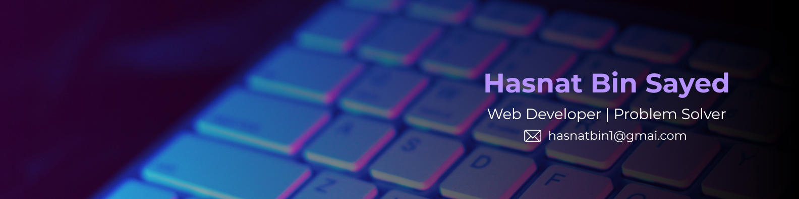

  

<h1 align="center">Hasnat Bin Sayed</h1>

  

  Building practical web applications with clean APIs, reliable databases, and user-focused interfaces.

  
  
  

  
  

---

## 👋 About Me

I'm a Computer Science and Engineering undergraduate at **International Islamic University Chittagong (IIUC)** with a strong interest in full-stack development, backend engineering, and database systems.

I enjoy turning ideas into functional applications, designing REST APIs, working with relational and NoSQL databases, and learning how to build software that is maintainable and scalable.

- 🎓 CSE undergraduate at IIUC
- 🧑‍🏫 Undergraduate Teaching Assistant for Software Engineering and Compiler Construction labs
- 💻 Building full-stack applications using React, Node.js, Express, and modern databases
- 🗄️ Exploring backend architecture, authentication, API design, and database modeling
- 🌱 Currently developing my skills in TypeScript, Prisma, and Next.js
- 🎯 Seeking junior web development and full-stack internship opportunities

## 🛠️ Technical Skills

### Languages

  

### Frontend Development

  

### Backend Development

  

### Databases

  

### Tools & Platforms

  

## 📊 GitHub Activity

  
  

## 📫 Connect With Me

  
  &nbsp;
  
  &nbsp;
  
  &nbsp;
  

  <i>Always learning. Always building.</i>

